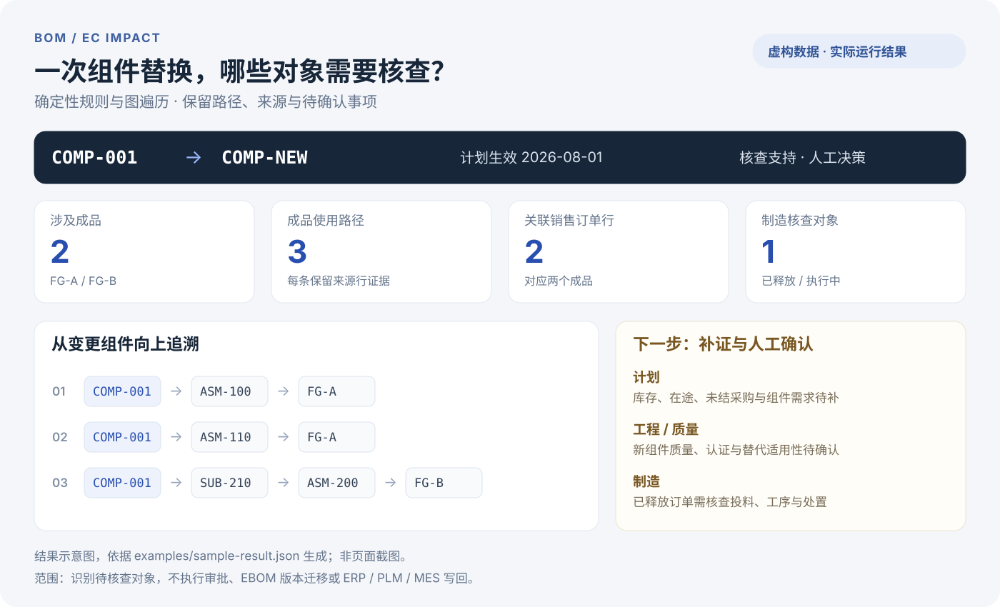

# BOM Engineering Change Impact

[](https://github.com/JulieY7899/bom-ec-change-impact/actions/workflows/verify.yml)

**V1.1-mac2 (0.2.2).** Failed import batches preserve the previous snapshot; browser and downloaded reports now include sales lines, quantity deltas and review reasons. All 55 regressions passed. Of 25 previously approved business cases, 23 passed and 2 remain capability gaps. **Remaining gaps: B19 purchase commitments/receipts and B22 engineering versions/order references.** See the [verification record](docs/evaluation.md) for scope and limitations.


**Local decision support for engineering change reviews**

[中文](README.md) | English

When a component changes, which products and orders need review? What evidence supports the result, and what still needs confirmation by engineering, procurement and planning?

This prototype uses imported multilevel BOMs, orders and proposed changes to trace dependencies, identify candidate impacts and produce a report with source evidence and open questions. Rules and graph traversal perform the analysis.

**Status: independent prototype demonstrated with synthetic data. External AI calls are disabled in this build.** The application does not approve changes or write to ERP, PLM or MES.



*This diagram is generated from the saved analysis output; it is not a UI screenshot.*

[Demo case](examples/README.md) · [Verification record](docs/evaluation.md) · [Business rules](docs/business-rules.md) · [Design decisions](docs/decisions.md)

## A change from input to evidence

The built-in dataset uses `COMP-001` in two products, `FG-A` and `FG-B`. The example proposes replacing it with `COMP-NEW`, effective `2026-08-01`.

| Review question | Example output |
| --- | --- |
| Where is the component used? | Multilevel paths to both products, with source rows. |
| Which orders require review? | Two sales order records and one production order record within the current manufacturing scope. These are candidate impacts. |
| Is the new component ready? | Checks against imported master-data and sourcing evidence, with outstanding evidence requests. |
| Can material usage switch immediately? | Missing supply data remains an explicit gap. The tool does not issue purchasing or production instructions. |
| Can the result be checked? | Paths, order evidence, source IDs and worksheet rows allow review of the supporting inputs. |

These observations describe the repository's synthetic example. They are not production inventory, procurement commitments or measured business benefits. See the [demo case](examples/README.md) for the inputs and reproduction steps.

## What the prototype implements

| Capability | Current scope |
| --- | --- |
| Excel import and BOM traversal | Bidirectional traversal within the current imported snapshot, retaining source evidence. |
| Order association | Candidate selection using materials, sales order items and status. A shared sales order header alone no longer includes unrelated production orders. |
| Quantity changes | Theoretical component delta per finished-product unit. Ambiguous alternatives or incomplete usage evidence require review. |
| Effectivity changes | Comparison of date-filtered valid paths within one snapshot. |
| Planning and manufacturing review | Rule-based prompts, data gaps and recorded manual dispositions, subject to business confirmation. |
| Batch summaries and reports | Results grouped within the current review batch, with local evidence reports. |
| EBOM revisions and Order BOM migration | Business principles documented; the full revision model and migration execution are not implemented. |
| Enterprise integration, approval and write-back | Not implemented. |
| Model-generated explanation | Disabled in this build; no model-performance claims. |

## Design rationale

The application separates calculated candidate impacts from business decisions. It preserves open questions when configuration, revision or execution-state evidence is missing. Reports support a subsequent cross-functional review outside the application.

The key decisions are documented in [design decisions](docs/decisions.md), including deterministic calculations, conservative handling of incomplete inputs and the distinction between date filtering and revision migration.

## Author and implementation

**[JulieY7899](https://github.com/JulieY7899)** defines the business problem and modeling principles, drawing on manufacturing and supply chain experience. The design focuses on the responsibilities of engineering definitions, order configurations and factory execution, with cross-functional confirmation for engineering changes.

Code, tests and documentation are developed with AI assistance. Implemented features, business design principles and future work are identified separately. This repository's demonstrations and test results do not establish enterprise deployment or production benefits.

## Run locally

Requires **Python 3.11 or later**. The core application uses the Python standard library and has no third-party runtime dependencies. From the project root:

```bash
python3 app.py
```

Direct execution opens `http://127.0.0.1:8765` by default. On macOS, open `启动BOM助手.command` in Finder; the launcher selects an available port and saves the actual address in local `data/server.url`. This build fixes address-file creation on Mac. See the [verification record](docs/evaluation.md).

Use a separate project directory for your first demo, then select “载入虚拟演示数据” in the Chinese-language UI. **Loading demo data replaces the selected database's current imported snapshot and analysis results.** To use a separate database:

```bash
python3 app.py --database data/portfolio-demo.sqlite3
```

An empty Excel import template is available in the application. Use synthetic data for public demonstrations and repository submissions.

## Verify

From the project root:

```bash
PYTHONPATH=src python3 -m unittest discover -s tests -v
python3 scripts/run_example.py --check
node --check src/bom_change_assistant/web_assets/app.js
node scripts/check_frontend_metrics.cjs
python3 scripts/check_public_files.py
```

CI runs on Linux with Python 3.11 / 3.12 / 3.14 and macOS with Python 3.14. The badge links to the actual GitHub Actions results.

Coverage includes multilevel traversal, order association, effectivity boundaries, quantity completeness, review-batch isolation, reports and local HTTP behavior. See the [verification record](docs/evaluation.md) for the actual run environment, results and unverified areas.

## Data handling and limitations

- External model calls are blocked, including when `OPENAI_API_KEY` is present. The server is restricted to loopback addresses and checks Host and Origin headers.
- Local SQLite storage retains some business identifiers and is not encrypted at rest by the application. Databases, operational reports, logs and credentials are outside the public portfolio.
- An imported snapshot is not an independent EBOM revision. Date comparisons do not determine Order BOM migration, net material requirements or inventory consumption.
- Multi-file import does not yet provide atomic rollback of the entire snapshot. Check completeness after an import failure before analyzing it.
- This is a single-machine prototype without a production authorization model, enterprise integration or an approval workflow. Business benefits and adoption have not been validated in this prototype.

The next priorities are an explicit revision and order-reference model, complete-snapshot import and additional business boundary cases. Each extension should start with an expected behavior that can be verified.
