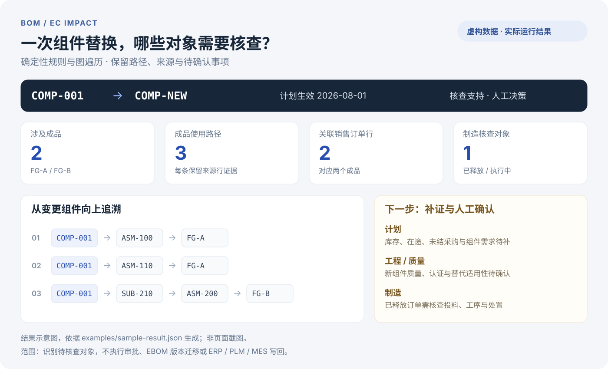
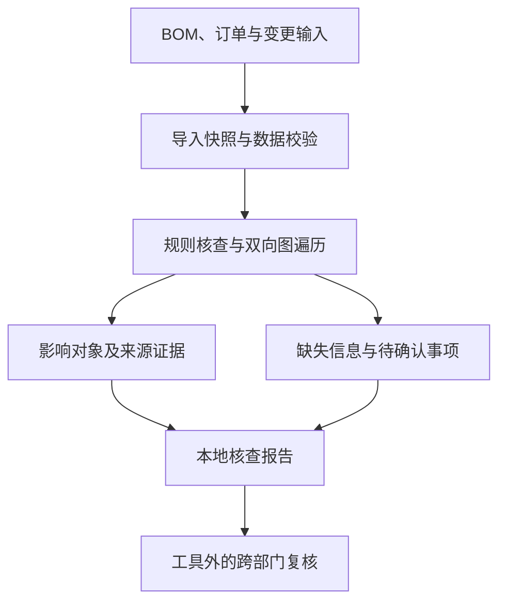

# BOM Engineering Change Impact

[](https://github.com/JulieY7899/bom-ec-change-impact/actions/workflows/verify.yml)

**V1.3-B22（0.4.0）** 支持按成品、工厂、工程版本和指定 BOM 行核查拟议变更。订单按明确版本引用命中，配置、执行状态和日期分别列出待核证据。网页和 Markdown 报告共用核查结果。[工程版本字段与示例](docs/engineering-versions.md)

V1.2-B19 的采购承诺、收货、退货及冲销核查继续可用。[采购导入说明](docs/procurement.md)

本地工作流把业务问题转成可确认的核查参数，可将预检结果带入「01 数据准备」，再按当前快照执行规则核查并生成报告。支持研发、采购、销售、制造和工程五个视角。「03 影响核查」为工程角色提供独立的 PPT 知识参考。[工作流使用说明](docs/workflow.md)

**工程变更影响核查 · 本地决策支持原型**

中文 | [English](README.en.md)

当一个组件变更时，哪些成品与订单需要核查？哪些结论有数据支持，哪些后续处置还需要工程、采购与计划人员确认？

这个工具从导入的多层 BOM、订单和变更记录出发，用规则与图遍历整理影响路径、关联订单、来源证据和待确认事项。结果可在页面查看，并导出为 Markdown 报告。

**当前状态：独立原型，使用虚构数据展示；本版本禁用外部 AI 调用。** 工具不执行审批，也不写回 ERP、PLM 或 MES。



*图示根据保存的实际分析结果生成，非页面截图。*

[演示案例](examples/README.md) · [历史验证记录](docs/evaluation.md) · [业务规则](docs/business-rules.md) · [设计决策](docs/decisions.md)

## 从一个变更看完整过程

内置演示中，`COMP-001` 被 `FG-A` 和 `FG-B` 共用。提出将它替换为 `COMP-NEW`，计划生效日为 `2026-08-01`。

| 核查问题 | 本例中的输出 |
| --- | --- |
| 组件用在哪里？ | 展示通往两个成品的多层 BOM 路径及来源行。 |
| 哪些订单需要核查？ | 列出两条销售订单记录；按当前制造范围筛出一条生产订单记录。关联表示候选影响范围。 |
| 新组件可以放行吗？ | 检查已导入的主数据与寻源证据；本例仍有待补证项目。 |
| 可以直接切换用料吗？ | 供应数据未提供，结果保留“待补供应数据”，不据此下达采购或生产动作。 |
| 如何核对结论？ | 沿着路径 ID、来源编号、工作表行号和订单证据回看依据。 |

以上是本仓库合成数据的行为示例，不代表企业的真实库存、采购承诺或业务收益。详细输入与复现步骤见[演示案例](examples/README.md)。

## 已实现与设计边界

| 能力 | 状态与范围 |
| --- | --- |
| Excel 导入与多层 BOM 追溯 | 已实现；在当前导入快照内执行双向追溯，保留来源记录。 |
| 订单关联 | 已实现；结合物料、销售订单行和状态筛选候选对象，不再仅凭销售订单抬头号扩入生产订单。 |
| 用量变化 | 已实现单位成品理论差量；存在替代组、结构缺失或用量证据不足时保留人工复核。 |
| 生效日期变化 | 已实现同一快照在两个日期的有效路径比较。 |
| 计划与制造核查 | 已实现规则提示、待补数据及人工处置记录；建议需业务复核。 |
| 采购承诺与到货 | 已实现采购行与收货/退货/全额冲销核查；按范围、单位和截至日分组；不自动加入库存或备料公式。 |
| 批次与报告 | 已实现当前核查批次的结果汇总，以及带证据的本地报告。 |
| 独立 EBOM 版本与 Order BOM 引用 | 支持按成品、工厂、工程版本和稳定 BOM 行核查明确的订单引用。版本迁移由正式业务流程执行。 |
| 企业系统集成、审批与订单回写 | 未实现。 |
| 模型解释 | 本版本关闭；没有模型效果评估结果。 |

## 设计思路



核心取舍是让影响计算有确定的规则、可追溯的输入和明确的适用边界。缺少配置、版本或执行状态时，系统保留不确定性；报告供业务人员作进一步判断。详见[设计决策](docs/decisions.md)。

## 作者与实现

项目作者：**[JulieY7899](https://github.com/JulieY7899)**。

本项目把作者的制造业与供应链业务经验，转化为可审阅的业务规则和独立演示原型。业务建模重点是工程定义、订单配置与工厂执行的职责边界，以及工程变更中的跨部门确认。

代码、测试与文档使用 AI 辅助开发。仓库中已实现的功能、业务设计原则和后续工作分别标注；这里的演示与测试结果不作为企业部署或生产收益的证明。

## 本地运行

需要 **Python 3.11 或更新版本**。核心应用只使用 Python 标准库，无需安装第三方运行依赖。在项目根目录执行：

```bash
python3 app.py
```

直接运行默认打开 `http://127.0.0.1:8765`。macOS 可在 Finder 中双击 `启动BOM助手.command`；启动器会避开已占用端口，并把实际地址写入本机 `data/server.url`。本版修复了 Mac 地址文件保存问题，详见[历史验证记录](docs/evaluation.md)。

首次体验请使用独立的项目目录，然后点击“载入虚拟演示数据”。**这个操作会替换所选数据库的当前导入快照与分析结果。** 需要独立数据库时可运行：

```bash
python3 app.py --database data/portfolio-demo.sqlite3
```

使用自己的数据时，可以先下载页面提供的空白 Excel 模板。公开演示与提交代码请始终使用虚构数据。

## 验证

在项目根目录运行：

```bash
PYTHONPATH=src python3 -m unittest discover -s tests -v
python3 scripts/run_example.py --check
node --check src/bom_change_assistant/web_assets/app.js
node --check src/bom_change_assistant/web_assets/workflow.js
node scripts/check_frontend_metrics.cjs
python3 scripts/check_public_files.py
```

自动测试覆盖 Linux 上 Python 3.11 / 3.12 / 3.14，以及 macOS 上 Python 3.14；运行状态以本页徽章和 Actions 记录为准。

测试覆盖采购对账、多层追溯、订单关联、日期边界、用量完整性、批次隔离、报告和本地 HTTP 接口。当前运行结果见 [GitHub Actions](https://github.com/JulieY7899/bom-ec-change-impact/actions/workflows/verify.yml)。

## 最近修复

- **生产订单状态**：按完整 SAP 状态码归类。`PCNF` 和 `REL PCNF` 属于「已释放/执行中」，订单数量为空时仍纳入核查和风险计数。
- **本机导入可靠性**：读取请求体时释放共享锁，校验长度并处理读取超时。上传未完成时仍可查询服务器和当前快照，失败或迟到的上传也不会替换已有快照。
- **快照备份**：每个数据库在导入成功后保留最近 3 份由新规则管理的备份，现有的旧命名备份保留。
- **核查性能**：BOM 按锚点读取可达子图。批次共用采购证据，单项报告与对应单项版本组使用同一份采购核查结果。

**旧快照需要重新导入。** 旧快照只保存归类后的状态。要纠正其中的 PCNF 误判，请使用原始 Excel 导出重新导入整批资料，然后重新运行核查并生成报告。

### PCNF 重新导入复验

- **脱敏实样。** 原样重新导入后，含 `PCNF` 的 4 条生产订单也都带有 `DLV`，且已交货数量等于订单数量。四条均归为「已完成」，未计入执行中订单。
- **对照测试。** 在同一 BOM 核查范围内，分别加入仅有 `PCNF` 和仅有 `REL PCNF` 的两条测试订单。两条均归为「已释放/执行中」，其中一条订单数量留空也仍纳入。关联生产订单数和风险依据中的执行中订单数均由 0 增至 2，网页结果与两种 Markdown 下载报告一致。

## 数据边界与已知限制

- 本版本阻断外部模型调用，设置 `OPENAI_API_KEY` 也不会启用；服务限定本机监听，并检查请求的 Host 与 Origin。
- 本地 SQLite 会保留部分业务编号，未实现数据库静态加密。`data/`、运行报告、日志与密钥均不属于公开作品内容。
- 当前导入快照不等同于独立 EBOM 版本；日期前后比较不能决定订单版本迁移，也不能代表库存扣减或净需求计算。
- 多文件按批次暂存。整批成功后先备份旧快照，再启用新快照。导入失败或取消时，继续使用原快照和已有分析。
- 当前是单机原型，没有生产环境的权限体系、系统集成或审批工作流。业务收益与用户采纳尚未在此原型中验证。

真实导出缺少工程版本、行位置键或订单引用时，先在工作流预检查看缺口。业务复核仍需回到对应的导出证据。
